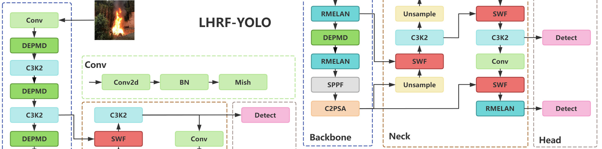

# LHRF-YOLO

Official PyTorch implementation of **LHRF-YOLO: A Lightweight Model with Hybrid Receptive Field for Forest Fire Detection** (Forests 2025, 16, 1095), built on Ultralytics YOLO.

Yifan Ma, Weifeng Shan, Yanwei Sui, Mengyu Wang, Maofa Wang

Paper: https://doi.org/10.3390/f16071095



*Network diagram from the paper (CC BY 4.0).*

## Overview

LHRF-YOLO targets forest fire detection on resource-constrained edge devices.
It starts from YOLO11n and adds four components:

| Paper module | Implementation | Purpose |
| --- | --- | --- |
| RMELAN | `ultralytics/nn/modules/lhrf.py` | Residual multi-branch ELAN with 2D selective scan for local and global context |
| DEPMD | `ultralytics/nn/modules/lhrf.py` | Patch-merge downsampling with SE recalibration and a learnable scale |
| SWF | `ultralytics/nn/modules/lhrf.py` | Scaling weighted fusion of multi-scale features |
| Mish | `ultralytics/nn/modules/conv.py` | Replaces SiLU as the default activation |

The network definition is `lhrf.yaml`. This release only adds the modules used by
the paper; unrelated research modules are not included.

## Results

FS-Dataset, 640x640 input:

| Model | P | R | F1 | mAP50 | mAP50-95 | Params (M) | GFLOPs |
| --- | --- | --- | --- | --- | --- | --- | --- |
| YOLO11n | 83.5 | 79.3 | 0.813 | 87.3 | 56.7 | 2.58 | 6.3 |
| LHRF-YOLO | 84.2 | 79.8 | 0.819 | 87.6 | 57.0 | 2.25 | 5.4 |

On the M4SFWD generalization set, LHRF-YOLO reaches 30.2 mAP50 and 52.9 precision.

## Repository structure

```
LHRF-YOLO/
  lhrf.yaml                  model definition
  data_fire-smoke.yaml       dataset configuration
  train.py                   training
  val.py                     validation
  predict.py                 inference
  export.py                  ONNX export
  assets/architecture.png    network diagram
  ultralytics/               minimal Ultralytics package
    nn/modules/lhrf.py       RMELAN, DEPMD, SWF, SSBlock and SS2D
    nn/modules/conv.py       Mish default activation
    nn/tasks.py              module registration
```

## Installation

Python 3.8+ and PyTorch 2.0+ are recommended.

```bash
git clone https://github.com/whynotnanfeng/LHRF-YOLO.git
cd LHRF-YOLO
pip install -r requirements.txt
```

Selective scan runs in pure PyTorch by default. If the optional
`selective_scan_cuda` extension from VMamba is installed, it is used automatically
for faster training and inference.

## Dataset

The paper uses FS-Dataset: 19,866 images of fire, smoke and other scenes, split
into 12,083 training, 5,640 validation and 2,143 test images.

Download:

- Baidu Netdisk: https://pan.baidu.com/s/1_Xti5AoIER3yZ5hQhToSZQ (code: `m58i`)
- Google Drive: https://drive.google.com/file/d/1VFYYXHbzDTtgjTUU8cl6qNgi8ZahxGSe/view?usp=sharing
- Quark Netdisk: https://pan.quark.cn/s/c13d3a6251c0 (code: `4aii`)

Expected layout:

```
datasets/FS-Dataset/
  train/images
  train/labels
  valid/images
  valid/labels
  test/images
  test/labels
```

Labels are in YOLO format. Classes are `fire`, `others` and `smoke`. If your
split folders have different names, edit `data_fire-smoke.yaml`.

## Training

```bash
python train.py
```

The defaults follow the paper: 100 epochs, batch 64, 640x640, AdamW with
lr 0.001, momentum 0.937 and weight decay 0.0005. Change `device`, `workers`
and `batch` in `train.py` for your hardware. Checkpoints and logs are saved to
`runs/train/lhrf_yolo`.

Training from scratch is the default (`pretrained=False`). Set
`pretrained=True` if you want to initialise the YOLO11n backbone from COCO
weights.

## Validation and inference

```bash
python val.py
python predict.py
```

Both scripts read `runs/train/lhrf_yolo/weights/best.pt`. Change the checkpoint
path to evaluate or run another model.

## Deployment

Export to ONNX:

```bash
python export.py
```

For Jetson or other edge devices, run the exported model with TensorRT or ONNX
Runtime. A typical pipeline is:

1. Train on a GPU machine and export `best.onnx`.
2. Build a TensorRT engine on the target device (`trtexec --onnx=best.onnx --fp16`).
3. Resize and letterbox frames to 640x640, run inference, then map boxes back to
   the original image size.

The model uses only standard convolutions, element-wise ops, LayerNorm and the
selective scan. The scan falls back to PyTorch loops when no CUDA kernel is
available, so CPU inference is possible but slower than GPU inference.

## Citation

```bibtex
@Article{Ma2025LHRF,
  author  = {Ma, Yifan and Shan, Weifeng and Sui, Yanwei and Wang, Mengyu and Wang, Maofa},
  title   = {LHRF-YOLO: A Lightweight Model with Hybrid Receptive Field for Forest Fire Detection},
  journal = {Forests},
  volume  = {16},
  number  = {7},
  pages   = {1095},
  year    = {2025},
  doi     = {10.3390/f16071095}
}
```

## License

AGPL-3.0. This repository includes code from Ultralytics YOLO, which is licensed
under AGPL-3.0. See `LICENSE`.

## Acknowledgements

- Ultralytics YOLO: https://github.com/ultralytics/ultralytics
- VMamba selective scan: https://github.com/MzeroMiko/VMamba
- M4SFWD dataset: Wang et al., Expert Systems with Applications, 2024


